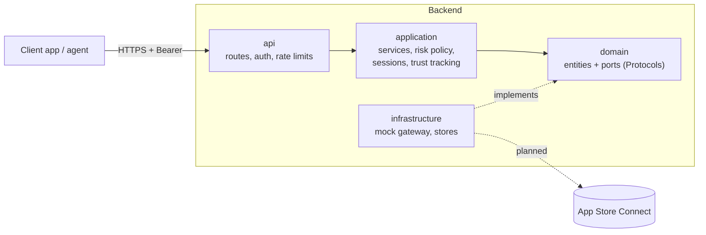
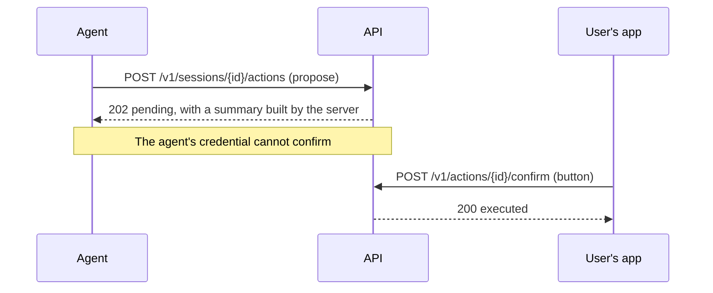

# Voice Release Assistant

[](https://github.com/sglushchenko/voice-release-assistant/actions/workflows/ci.yml)


A backend for an AI assistant that helps iOS release managers: ask about builds, TestFlight testers, customer reviews and sales, and **approve risky App Store Connect actions deliberately**. Voice and LLM layers are built on top of it. The service is written so that an agent can propose changes but never carries them out on its own.

The project is also a hands-on comparison of two voice-agent platforms, **ElevenLabs** and **OpenAI**, integrated at several levels of control (see [Roadmap](#roadmap)).

## Status

| | |
|---|---|
| Backend API (auth, reads, confirmed writes, analytics) | **Done**, 230+ tests, coverage floor of 90% enforced in CI |
| App Store Connect data | Mock by default. A **real read-only adapter** (apps, versions, builds, TestFlight, reviews) is selectable; writes and sales/engagement reports answer "not supported yet" ([ADR 0010](docs/adr/0010-real-app-store-connect-backend-read-only.md)) |
| State (sessions, pending actions, rate-limit counters) | In memory: lost on restart, single process |
| Agent core: provider-neutral loop, tool table, limits, scripted model, injection scenario in CI | **Done** |
| OpenAI adapter for the agent | **Done**, tested without network; one opt-in live test (`make live`) |
| Evaluations: scripted tier gates CI, LLM tier run by hand, history of results | **Done**, see [evals](evals/README.md); no real-model run recorded yet |
| Terminal chat with the agent (`make chat`) | **Done** |
| Chat endpoint, Langfuse tracing, voice (ElevenLabs / OpenAI), iOS client | Planned |

The real backend is read-only by design: nothing in this repository changes your App Store Connect account yet.

## Highlights

- **A model can propose, never execute.** Every write is a two-step flow: propose, then a person confirms through a separate channel. The channel and the right to confirm come from the credential, not from the request ([ADR 0002](docs/adr/0002-risk-tiered-tools-and-confirmation-policy.md), [0004](docs/adr/0004-http-api-authentication-and-authority.md)).
- **Prompt-injection aware by construction.** Customer reviews are third-party text. Reading them marks the session untrusted, and every risky action in that session then requires a button press ([ADR 0003](docs/adr/0003-prompt-injection-defense.md)).
- **Clean Architecture with swappable edges.** Domain and services depend only on protocols; the mock gateway and the real one are interchangeable.
- **Production hygiene:** structured JSON logs with redaction, request ids, password login with argon2id and sliding sessions ([ADR 0005](docs/adr/0005-single-operator-authentication.md)), layered rate limiting and body-size cap ([ADR 0006](docs/adr/0006-abuse-protection.md)), strict typing, a committed OpenAPI contract, a hardened container.

## Architecture



Dependencies point inward: `api` and `infrastructure` know about `application` and `domain`; `domain` knows nothing. `bootstrap.py` is the only place where concrete implementations are wired together.

### How a write is approved



How strictly an action is approved depends on its risk tier (read, reversible, public, irreversible), on configuration, and on whether untrusted text was read in the session. Configuration can tighten but never loosen below the tier's floor.

### Repository layout

| Path | Purpose |
|---|---|
| `backend/src/release_assistant/domain/` | Entities, ports (protocols), domain errors |
| `backend/src/release_assistant/application/` | Services per area (apps, builds, testers, reviews, sales, engagement), risk and confirmation policy, sessions, trust tracking |
| `backend/src/release_assistant/infrastructure/` | In-memory gateway and fixtures, the read-only App Store Connect adapter (`appstoreconnect/`), composite gateway, pending-action store |
| `backend/src/release_assistant/api/` | FastAPI app: routes, authentication, rate limiting, middleware |
| `backend/src/release_assistant/agent/` | Agent core: loop, tool table, HTTP tool backend, conversation store, scripted model |
| `backend/src/release_assistant/observability/` | Structured logging setup |
| `docs/adr/` | Architecture Decision Records |
| `docs/openapi.json` | The API contract, checked by a test |
| `evals/` | Evaluation cases, the scripted baseline and the history of results ([details](evals/README.md)) |
| `ios/`, `benchmarks/` | Placeholders for the client and the provider comparison |

## Quick start

Requires [uv](https://docs.astral.sh/uv/) and Python 3.14 (uv fetches it), or Docker.

### 1. Create credentials

The server stores **hashes only**. Never put a plain password or key in configuration.

```bash
cd backend
cp .env.example .env
uv run release-assistant-hash-password   # prompts for a password, prints an argon2id hash
```

An agent uses a static API key; store its SHA-256:

```bash
printf '%s' "choose-a-long-random-key" | shasum -a 256 | cut -d' ' -f1
```

Edit `.env` (values containing `$` go in single quotes):

```bash
RELEASE_ASSISTANT_ADMIN_USERNAME=alice
RELEASE_ASSISTANT_ADMIN_PASSWORD_HASH='$argon2id$v=19$...'
RELEASE_ASSISTANT_API_CLIENTS=[{"subject":"agent","owner":"alice","key_sha256":"<hash>","scopes":["read","propose"]}]
```

The `owner` of every API client must equal the admin username, so the agent and the user share the same sessions and pending actions; the server refuses to start otherwise. Changing a password means generating a new hash and restarting, which also ends every login.

### 2. Run

```bash
make run                                  # local, from backend/
```

or in a hardened container, from the repository root:

```bash
docker compose up --build                 # published on 127.0.0.1:8000 only
```

### Chat with the agent in a terminal

With `RELEASE_ASSISTANT_OPENAI_API_KEY` in your `.env` (it spends a few cents of tokens):

```bash
cd backend && make chat
```

It runs the real API in process; the agent can read and propose, and only you can approve with `/confirm <id>`. `/trace` shows which tools ran, `/pending` lists waiting changes, `/help` the rest. Select the real account with `RELEASE_ASSISTANT_BACKEND=appstoreconnect` (read-only) and check it first with `make live-asc`.

### 3. Try it

```bash
B=http://127.0.0.1:8000

# Log in as the user and keep the token
TOKEN=$(curl -s -X POST $B/v1/auth/login -H 'Content-Type: application/json' \
  -d '{"username":"alice","password":"<your password>"}' | python3 -c 'import sys,json; print(json.load(sys.stdin)["access_token"])')

curl -s $B/v1/apps -H "Authorization: Bearer $TOKEN"

# Propose a change (here with the agent's key) ...
SESSION=$(curl -s -X POST $B/v1/sessions -H "Authorization: Bearer <agent key>" \
  | python3 -c 'import sys,json; print(json.load(sys.stdin)["session_id"])')
ACTION=$(curl -s -X POST $B/v1/sessions/$SESSION/actions -H "Authorization: Bearer <agent key>" \
  -H 'Content-Type: application/json' \
  -d '{"action":"add_tester","arguments":{"group_id":"group-1","email":"new@example.com"}}' \
  | python3 -c 'import sys,json; print(json.load(sys.stdin)["action"]["id"])')

# ... the agent cannot confirm it (403) ...
curl -s -X POST $B/v1/actions/$ACTION/confirm -H "Authorization: Bearer <agent key>" \
  -H 'Content-Type: application/json' -d '{"channel":"button"}'

# ... the user can
curl -s -X POST $B/v1/actions/$ACTION/confirm -H "Authorization: Bearer $TOKEN" \
  -H 'Content-Type: application/json' -d '{"channel":"button"}'
```

Sample data: apps `app-1` (Pocket Notes) and `app-2` (Habit Garden), TestFlight groups `group-1` and `group-2`, three reviews.

## API

The contract is [`docs/openapi.json`](docs/openapi.json); generate a client from it. Interactive docs are off by default (`RELEASE_ASSISTANT_DOCS_ENABLED=true` to serve `/docs`). Every route except `/healthz` requires `Authorization: Bearer <token>`. Errors share one shape: `{title, status, code, detail}`.

| Area | Routes |
|---|---|
| Auth | `POST /v1/auth/login`, `POST /v1/auth/logout`, `GET /v1/auth/me` |
| Catalog | `GET /v1/apps`, `/v1/apps/{id}/versions`, `/v1/apps/{id}/builds`, `/v1/apps/{id}/builds/latest`, `/v1/versions/in-review`, `/v1/versions/rejected` |
| TestFlight | `GET /v1/apps/{id}/beta-groups`, `/v1/beta-groups/{id}/testers` |
| Reports | `GET /v1/reports/sales/monthly`, `/v1/reports/engagement`, `/v1/reports/engagement/recent` |
| Sessions and reviews | `POST /v1/sessions`, `GET /v1/sessions/{id}/apps/{app}/reviews[/unanswered]` (reviews are labelled `trust: untrusted`) |
| Writes | `POST /v1/sessions/{id}/actions` (propose), `GET /v1/actions[/{id}]`, `POST /v1/actions/{id}/confirm`, `POST /v1/actions/{id}/reject` |
| Ops | `GET /healthz` |

Available actions: `add_tester`, `remove_tester`, `respond_to_review`.

Sales figures are **estimates** from Sales and Trends, kept per currency and never summed across currencies; engagement figures (impressions, page views) come from a different Apple source and report how much of the requested period is actually published.

## Configuration

All settings are environment variables with the prefix `RELEASE_ASSISTANT_` (or a local `.env`); see [`backend/.env.example`](backend/.env.example).

| Variable | Default | Purpose |
|---|---|---|
| `ADMIN_USERNAME`, `ADMIN_PASSWORD_HASH` | unset | The human account; both unset disables password login |
| `API_CLIENTS` | `[]` | JSON list of static keys (`subject`, `owner`, `key_sha256`, `scopes`) |
| `ACCESS_TOKEN_TTL_MINUTES` | `480` | Login lifetime when idle; each use extends it |
| `LOGIN_MAX_FAILURES`, `LOGIN_LOCKOUT_MINUTES` | `5`, `15` | Lockout after repeated failed logins |
| `RATE_LIMITS` | see below | Per-policy overrides, e.g. `{"login":"3/minute"}` |
| `RATE_LIMIT_STORAGE` | `async+memory://` | Counter store; `async+redis://...` for several instances |
| `MAX_REQUEST_BYTES` | `65536` | Largest request body |
| `CORS_ORIGINS` | `[]` | Exact browser origins allowed (none for native apps; `*` is refused) |
| `DOCS_ENABLED` | `false` | Serve `/docs` and `/openapi.json` |
| `OPENAI_API_KEY` | unset | **Secret.** The agent's language model key; only in your own git-ignored `.env` |
| `OPENAI_MODEL`, `OPENAI_REASONING_EFFORT` | `gpt-5-mini`, unset | Model name as your account lists it; reasoning effort (`minimal` to `high`) if the model supports it |
| `OPENAI_MAX_OUTPUT_TOKENS`, `OPENAI_TIMEOUT_SECONDS`, `OPENAI_BASE_URL` | `2000`, `30`, unset | Reply ceiling, provider timeout, and an optional OpenAI-compatible server |
| `BACKEND` | `mock` | `mock` or `appstoreconnect` (read-only); the latter also needs the three below |
| `APPSTORE_KEY_ID`, `APPSTORE_ISSUER_ID`, `APPSTORE_PRIVATE_KEY_PATH` | unset | App Store Connect API key; the `.p8` is a **secret** kept outside the repo with owner-only permissions |
| `APPSTORE_TIMEOUT_SECONDS` | `20` | Per-request timeout |
| `TRUSTED_PROXIES` | `127.0.0.1` | Proxies whose `X-Forwarded-For` is believed |
| `HOST`, `PORT` | `127.0.0.1`, `8000` | Bind address |
| `LOG_LEVEL`, `LOG_JSON` | `INFO`, `true` | Logging |

Rate-limit policies and defaults: `ip` 20/second, `principal` 20/second, `login` 10/minute, `propose` 30/minute, `reports` 20/minute, `reviews` 60/minute.

### Deployment notes

- Passwords travel in requests, so expose the service **only behind a reverse proxy that terminates TLS**. It binds to loopback by default.
- List that proxy in `TRUSTED_PROXIES`; otherwise every client appears to share the proxy's address and limits and lockouts apply to all of them at once.
- In-process limits stop mistakes and simple abuse, not a distributed denial of service; that is for the proxy, a CDN or the network provider ([ADR 0006](docs/adr/0006-abuse-protection.md)).
- State is in memory. Run a single instance for now.

## Development

```bash
cd backend
make install    # uv sync --frozen
make check      # ruff, ruff format, mypy --strict, pytest with a 90% coverage floor
make openapi    # regenerate docs/openapi.json after changing the API
make image      # build the container image
make live       # opt-in: run tests that call a real model (needs your key, spends tokens)
make eval       # scripted evaluations against the baseline (free, offline; what CI runs)
make eval-llm   # evaluations with a real model (spends tokens, run rarely, appends to evals/history.csv)
make eval-compare  # compare the two newest LLM runs case by case
```

A test fails if `docs/openapi.json` is out of date, and CI runs the same checks plus a container smoke test.

Adding a capability follows the layers: define or extend a port in `domain/ports.py`, implement it in the mock gateway, add a service (and, for writes, an `ActionDefinition` with a risk tier) in `application/`, then expose it in `api/routes/`. Writes never bypass `ActionService`.

## Roadmap

1. Real App Store Connect: reports (sales, engagement) and, behind an explicit switch, writes. Reading is done.
2. Persistence for sessions and pending actions.
3. Tracing with Langfuse, and a chat endpoint that exposes the agent.
4. Voice: ElevenLabs and OpenAI integrated at several levels of control, with measured latency, cost and quality.
5. A SwiftUI client.

## Architecture decisions

| ADR | Decision |
|---|---|
| [0001](docs/adr/0001-monorepo-with-private-notes.md) | One public monorepo |
| [0002](docs/adr/0002-risk-tiered-tools-and-confirmation-policy.md) | Risk-tiered actions and a configurable confirmation policy |
| [0003](docs/adr/0003-prompt-injection-defense.md) | Defense in depth against prompt injection |
| [0004](docs/adr/0004-http-api-authentication-and-authority.md) | Scoped credentials decide who may confirm what |
| [0005](docs/adr/0005-single-operator-authentication.md) | Single-operator authentication: password login, keys for the agent |
| [0006](docs/adr/0006-abuse-protection.md) | Rate limits and request size cap |
| [0007](docs/adr/0007-server-side-agent-core.md) | A provider-neutral agent core on the server |
| [0008](docs/adr/0008-openai-adapter-over-chat-completions.md) | The OpenAI adapter uses Chat Completions over the agent's own history |
| [0009](docs/adr/0009-evaluation-tiers-and-history.md) | Evaluations in two tiers, with a history that shows progress |
| [0010](docs/adr/0010-real-app-store-connect-backend-read-only.md) | The real App Store Connect backend starts read-only |

## License

[MIT](LICENSE)
